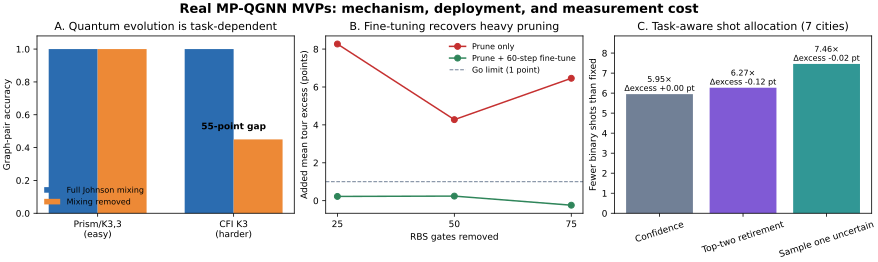

# MP-QGNN research MVPs — 30 October 2026

This note reports experiments on the real `SnehalRaj/mp-qgnns` implementation. It does not use a synthetic oracle or a surrogate model.



## How to read the main metric

**Tour excess** is the fractional extra length of the greedy predicted tour relative to the known optimal tour. Zero is optimal. An added excess of `0.0024` means **0.24 percentage points more tour length**, not “accuracy 0.0024.” Negative added excess means the revised method happened to find slightly shorter tours on average.

## Decisions

| Project | Pre-registered success test | Result | Decision | Paper potential / novelty / likely reach |
|---|---|---|---|---|
| When is quantum evolution necessary? | CFI gain ≥15 accuracy points and TSP gain ≥2 tour-excess points | Hard CFI: +55 accuracy points. Easy CFI: +0. TSP: compound evolution changes unseen-size excess by only +0.05 point; message-passing removal is harmful only when gates are removed after training | **PIVOT** to a task-dependent necessity/dequantization paper | **8 / 10**, **7 / 10**, **8 / 10** |
| Train classical, deploy an RBS circuit | Fidelity ≥0.999999; remove 50% gates and add ≤1 tour-excess point after fine-tuning | Minimum state fidelity `0.999999999999886`; 50% pruning + fine-tuning adds 0.24 point in the robustness run | **PASS** | **8 / 10**, **7 / 10**, **8 / 10** |
| Sequential shot retirement | ≥1.20× fewer shots than confidence stopping, ≥4× fewer than fixed, ≤0.1 excess point, ≥95% decoder agreement | Revised 7-city policy: 1.253× fewer than confidence and 7.46× fewer than fixed; −0.02 excess point, but only 84.1% exact-tour agreement | **PIVOT** because task loss passes but the agreement gate fails | **6 / 10**, **6 / 10**, **7 / 10** |

The scores are judgment calls, not measured probabilities. “Likely reach” estimates how many adjacent conversations the idea could affect: QGNN mechanism ablations, dequantization, classical training/quantum deployment, circuit compression, and hardware measurement cost.

## Project 1 — quantum evolution necessity

**Mechanism.** Remove Johnson mixing from the CFI model and remove compound evolution or adjacency propagation from the TSP model while keeping encoders and readout fixed.

**What happened.** The easy prism/K3,3 pair was saturated: both full and zero-mixing models scored 100%, so it could not diagnose the quantum layer. On the harder CFI-K3 family, full mixing scored 100% while zero mixing scored 45%. Independently trained TSP ablations did not show a stable full-model advantage on unseen 6- and 7-city graphs. A stricter counterfactual control—neutralizing gates only after a full model was trained—raised tour excess by 1.8–2.2 points without compound evolution and 5.6–7.9 points without adjacency propagation.

**Interpretation.** The components can matter to the learned solution without being necessary to reach similar TSP task performance after retraining. That distinction is the paper: *functional reliance* is not the same as *irreducible expressivity*.

**Next experiment.** Repeat the same three controls on QM9 and CFI order sweeps, then relate the first non-saturated order to the model's WL separation claim.

## Project 2 — classical training to RBS deployment

**Mechanism.** Fit each learned orthogonal MP-QGNN layer with the repository's exact RBS-pyramid gate order, evaluate the actual PennyLane weight-​`k` block, prune low-sensitivity angles, and fine-tune only the surviving circuit.

**What happened.** The compiled circuit matches held-out reduced-basis states to at least `0.999999999999886` fidelity. The largest direct PennyLane block error was `1.42e-15`. Pruning without adaptation was poor (4.3–8.3 added tour-excess points). After 60 fine-tuning steps, removing 25%, 50%, or 75% of RBS gates changed mean tour excess by +0.22, +0.24, and −0.24 point respectively across three seeds.

**Interpretation.** Exact deployment is solved at simulator level; the interesting result is that aggressive structured pruning needs post-pruning adaptation but can recover task quality. No hardware claim is made yet.

**Next experiment.** Run the compiled 50% and 75% circuits on two hardware backends and report wall-clock time, calibration drift, mitigation cost, and tour excess against the reduced-basis reference.

## Project 3 — measurement allocation

**Mechanism.** Start each candidate edge with 32 Bernoulli shots, retire candidates whose upper confidence bound cannot beat the leader, and then sample only the less certain member of the leading pair.

**What happened.** On five-city tests, the existing confidence policy was already 12.66× cheaper than fixed allocation; ordinary top-two retirement improved this by only 1.7%. The evidence-driven revision was therefore tested on 7-city graphs. It became 1.253× cheaper than confidence stopping and 7.46× cheaper than fixed shots, with essentially unchanged mean tour excess. Exact-tour agreement with the noiseless decoder was 84.1%, below the pre-registered 95% gate; even the confidence baseline reached only 86.5% at this harder size.

**Interpretation.** Exact permutation agreement is stricter than end-task cost because different tours can have similar lengths. The method is worth pursuing only after adding confidence intervals and a hardware-observable covariance model.

**Next experiment.** Pre-register both tour-regret and exact-permutation criteria, then measure grouped Pauli observables rather than independent Bernoulli edge probabilities.

## Reproduction record

Environment: Python 3.11, PyTorch double precision, real repository classes `EquivariantQGNN` and `TSPQGNN`. Training used five seeds (`0–4`), 120 five-city instances per seed, 120 epochs, and 64 held-out instances at each of 5, 6, and 7 cities. The pruning curve used three seeds and 60 recovery steps. The 7-city readout used 40 graphs per seed, 24 shot-noise repeats, 32-shot batches, and a 2,048-shot cap per candidate.

```bash
python -m pytest -q
python experiments/radar_2026_10_30.py pilot --output results/radar_2026_10_30_pilot.json
python experiments/radar_2026_10_30.py full --output results/radar_2026_10_30_full.json
python experiments/radar_2026_10_30_robustness.py --output results/radar_2026_10_30_robustness.json
python experiments/plot_radar_2026_10_30.py
python -m pytest -q
```

Raw machine-readable outputs are in `results/radar_2026_10_30_{pilot,full,robustness}.json`. The first full run took 71.3 seconds and the robustness revision took 38.1 seconds on this machine. These runtimes exclude dependency installation and manual analysis.

## Evidence limits

- All task results are simulator results; no QPU was used.
- The TSP training set is deliberately small for an MVP and has no classical GNN performance baseline yet.
- RBS fidelity tests circuit equivalence, not hardware fidelity.
- The readout currently samples edge probabilities independently and therefore omits covariance and observable grouping.
- The CFI result needs more graph orders and confidence intervals before it supports an expressivity theorem or an empirical scaling claim.

## Collaborator questions, not outreach

- **Saverio Monaco and Jamal Slim:** Can their observable back-propagation/pruning method exploit U(1)-preserving RBS layers with graph-conditioned inputs, and would they co-design a hardware validation of the compiled 50–75% pruned circuits?
- **Marcin Płodzień:** Does identity-reservoir competitiveness persist on discriminative graph tasks, and would he compare Pauli-propagation diagnostics with the CFI/TSP split reported here?

No email or message was sent.
