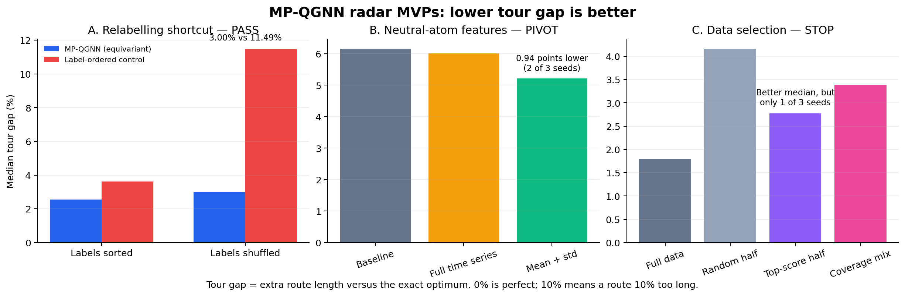

# MP-QGNN radar MVP results — 13 November 2026

## What the numbers mean

The main metric is **tour gap**: how much longer the model's TSP route is than the
exact optimum. A gap of 0% is perfect. A gap of 10% means the decoded route is 10%
too long. All headline values below are medians over seeds 0, 1 and 2, and lower
is better.



## Decisions

| Idea | Result | Decision | Paper likelihood | Novelty | Potential impact |
|---|---:|---|---:|---:|---:|
| S_n equivariance prevents a graph-label shortcut | 3.00% versus 11.49% after random relabelling | **PASS** | 8/10 | 7/10 | 8/10 |
| Neutral-atom correlations as MP-QGNN features | 6.16% to 5.22%; 2/3 seeds improve | **PIVOT** | 6/10 | 7/10 | 7/10 |
| V-information graph selection | 4.16% to 2.78% median transfer, but only 1/3 seeds improves | **STOP** | 3/10 | 5/10 | 5/10 |

The scores are research judgments, not measured probabilities. “Potential impact”
means breadth of papers or experiments that could reasonably use the idea if the
result survives a larger study.

## 1. Permutation invariance versus shortcut learning — PASS

**Mechanism.** The standard MP-QGNN orders RBS interactions from geometry, so a
node relabelling does not change the computation. The control orders the same RBS
gates by node label. It has the same trainable parameters and is trained on labels
sorted by x-coordinate. At test time, the same graphs are randomly relabelled.

| Model | Sorted labels | Random labels | Relabelling penalty |
|---|---:|---:|---:|
| Equivariant MP-QGNN | 2.54% | 3.00% | +0.39 points |
| Label-ordered control | 3.62% | 11.49% | +8.13 points |

The equivariant model's random-label gap is **73.9% lower** than the control's.
Every seed shows the same direction. This clears the preregistered go metric.
Existing unit tests also check logit equivariance directly, which separates the
architectural property from noise in greedy decoding.

**Caveat.** This is one exact Euclidean TSP-6 shortcut, not yet CFI, QM9 or a QPU
result. The paper-worthy next step is a matrix of shortcuts and sizes, with a
matched non-quantum equivariant baseline and finite-shot decoding.

## 2. Neutral-atom quantum graph features — PIVOT

**Mechanism.** An exact six-atom Rydberg Hamiltonian produces connected occupation
correlations in AFM-like and FM-like quenches. These are supplied to the real
coordinate encoder and RBS angle network. The first version used the full time
series; after seed instability, the revision compressed each regime to mean and
standard deviation.

| Model | Parameters | Median gap | Seed gaps |
|---|---:|---:|---|
| MP-QGNN baseline | 7,145 | 6.16% | 7.18, 6.16, 2.13 |
| Full QGF series | 8,425 | 6.01% | 6.01, 4.69, 8.70 |
| Mean/std QGF | 7,785 | 5.22% | 5.97, 5.22, 3.50 |

The compressed revision gives a **15.3% relative** reduction but only **0.94
percentage points**, and improves two of three seeds. It therefore misses the
absolute two-point and all-seed reliability criteria.

**Caveat.** These are exact dimensionless simulations, not Pasqal hardware, and
they do not reproduce the paper's register-layout optimizer. A credible continuation
needs the authors' official features or QPU samples, nested cross-validation, and a
larger low-data sweep before calling the features complementary.

## 3. V-usable-information sample selection — STOP

**Mechanism.** A short MP-QGNN probe and null-input model score each TSP-5 graph by
the reduction in cross-entropy enabled by the input. The first attempt trains on
the top half. The revision retains high-score graphs but spreads the rest over score
quantiles to improve coverage. All selected models use 60 graphs; the full baseline
uses 120.

| Training set | TSP-5 gap | Frozen-weight TSP-6 transfer gap |
|---|---:|---:|
| Full 120 | 0.92% | 1.80% |
| Random 60 | 1.71% | 4.16% |
| Top-score 60 | 2.42% | 2.78% |
| Coverage-mixed 60 | 2.92% | 3.39% |

The top-score median looks favorable, but it beats random selection in only one of
three paired seeds and loses 1.50 points in-size against full data. The direction is
not reproducible, so this line stops under the preregistered rule.

## Reproduction

Environment: Python 3.11, CPU PyTorch, exact Euclidean TSP targets, greedy decoding.

```bash
python -m pytest -q
python experiments/radar_2026_11_13.py invariance --out results/radar_2026_11_13/invariance.json
python experiments/radar_2026_11_13.py qgf --out results/radar_2026_11_13/qgf.json
python experiments/radar_2026_11_13.py vinfo --out results/radar_2026_11_13/vinfo.json
python experiments/plot_radar_2026_11_13.py --out docs/research_notes/radar_2026_11_13_summary.png
python -m pytest -q
```

The JSON files contain dataset sizes, seeds, epoch counts, parameter counts, loss
snapshots, per-seed metrics, caveats, commands and the source commit.

## Recommended next move

Develop the **S_n shortcut result** into a focused paper: formalize when canonical
gate scheduling preserves graph isomorphism, add CFI and cross-size TSP controls,
and test whether finite shots amplify the penalty of a non-equivariant schedule.
