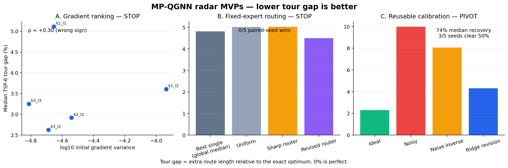

# MP-QGNN radar MVP results — 20 November 2026

## Plain-English headline

The **tour gap** measures how much longer the decoded route is than the exact
optimum. Zero is perfect; 10% means the route is 10% too long.



| Idea | Evidence | Decision | Paper likelihood | Novelty | Potential impact |
|---|---|---|---:|---:|---:|
| Initial gradient variance chooses the architecture | Variance grows from TSP-4 to TSP-8, but ranks model quality with the wrong sign | **STOP** | 3/10 | 6/10 | 6/10 |
| Soft routing over fixed MP-QGNN experts | Revised router has the best aggregate median but loses to the best single expert in every paired seed | **STOP** | 3/10 | 7/10 | 5/10 |
| One reusable feature calibration | Ridge correction recovers 74% of the median noise penalty, but clears the seed rule only 3/5 times | **PIVOT** | 6/10 | 6/10 | 7/10 |

These scores are research judgments, not measured probabilities.

## 1. Structure-aware trainability diagnostic — STOP

Five real MP-QGNN structures were compared by particle order `k`, layer count,
initial gradient variance and trained TSP-6 performance.

| Structure | Gradient variance | Parameters | Median tour gap |
|---|---:|---:|---:|
| k1_l1 | 2.22e-5 | 5,080 | 5.12% |
| k1_l2 | 1.16e-4 | 8,900 | 3.61% |
| k2_l2 | 2.87e-5 | 6,995 | 2.92% |
| k3_l2 | 2.05e-5 | 7,145 | **2.62%** |
| k3_l3 | 1.54e-5 | 9,825 | 3.25% |

The log-variance versus gap Spearman correlation is **+0.30**, while a useful
ranking should be negative. Parameter-normalizing the gradient makes it worse
(+0.60). The encouraging part is that gradient variance increases rather than
decays from TSP-4 to TSP-8 (log10 slope +0.252 per city), so this experiment does
not detect a barren plateau. But “no plateau” does not identify the useful model.

**Conclusion:** keep gradient scaling as a safety check, not an architecture
selector. A publishable continuation needs the paper's actual representation-
theoretic overlap quantities for the RBS symmetry sector, not a generic scalar.

## 2. Soft mixture of fixed MP-QGNN experts — STOP

The quantum/message backbones at orders k=1,2,3 were frozen. Only classical edge
heads and a size-free gate were trained on TSP-5; all weights were deployed
unchanged on TSP-6.

| Method | Effective experts | TSP-5 gap | TSP-6 transfer gap |
|---|---:|---:|---:|
| Best single by global median (k=2) | 1.00 | 3.29% | 4.82% |
| Uniform average | 3.00 | 2.94% | 5.02% |
| Sharp router | 1.00 | 2.98% | 5.03% |
| Revised router | 2.10 | **2.41%** | **4.50%** |

The sharp gate collapsed to one expert. Raising its temperature and adding an
entropy bonus produced a genuine mixture and a 6.5% aggregate transfer gain over
the global-median single expert. That apparent win is misleading: within each
seed, a different single expert wins, and the router loses all five paired
comparisons. This is expert-selection instability, not a reliable gain.

**Conclusion:** stop the current router. A next attempt would need held-out
expert selection, backbone diversity learned from graph structure, and a router
whose value is tested against a per-seed validation-selected single expert.

## 3. Reusable feature calibration — PIVOT

A fixed 20-dimensional local response corrupts the final MP-QGNN node features.
The response is estimated once using 21 probe settings and 256 shots per setting,
then reused for every test graph. This is a controlled synthetic channel, not an
IBM calibration.

| Inference | Median TSP-6 gap |
|---|---:|
| Ideal | 2.29% |
| Raw noisy | 9.98% |
| Naive pseudoinverse | 8.05% |
| Held-out-selected ridge inverse | **4.30%** |

The naive inverse amplifies finite-calibration error. The preregistered revision
selects ridge strength on calibration probes only and recovers **73.9%** of the
median noise penalty. It clears the “recover half” threshold in three of five
seeds, not the required four, and harms one seed by more than 0.5 point.

**Conclusion:** continue only as a PIVOT. Replace the artificial response by IBM
calibration records or device-derived channels and test whether a calibration
learned on TSP-5 transfers unchanged to TSP-6/7.

## Exact reproduction

```bash
PYTHONPATH=<cpu-dependencies>:$PWD/src python -m pytest -q
PYTHONPATH=<cpu-dependencies>:$PWD/src python experiments/radar_2026_11_20.py trainability --out results/radar_2026_11_20/trainability.json
PYTHONPATH=<cpu-dependencies>:$PWD/src python experiments/radar_2026_11_20.py moe --out results/radar_2026_11_20/moe.json
PYTHONPATH=<cpu-dependencies>:$PWD/src python experiments/radar_2026_11_20.py calibration --out results/radar_2026_11_20/calibration.json
PYTHONPATH=<cpu-dependencies>:$PWD/src python -m pytest -q
```

The JSON files contain exact seeds, splits, epoch counts, parameters, loss
snapshots, calibration budget, per-seed outcomes and caveats.
