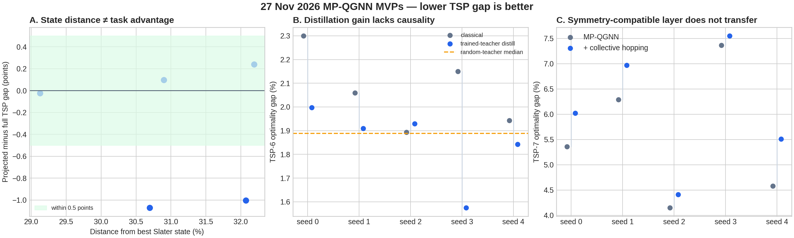

# MP-QGNN radar MVPs — 27 November 2026

## How to read the numbers

The main task metric is **TSP optimality gap**: `0%` means the predicted tour is optimal; smaller is better. A difference of one point means, for example, moving from a tour 5% longer than optimal to one 4% longer than optimal. Results use five paired random seeds, real `TSPQGNN` forward/training paths, and held-out random Euclidean TSP instances.



## Decisions

| Idea | Pre-registered success test | Result | Decision | Paper / novelty / likely impact (0–10) |
|---|---|---|---|---|
| Free-fermion dequantization boundary | ≥10% median distance from the best Slater state **and** ≥1-point task penalty in 4/5 seeds after fair head refit | 30.9% median Slater infidelity, but 0/5 seeds had a ≥1-point penalty; 3/5 were within 0.5 points | **PIVOT** — study nonlinear re-uploading and stronger free-fermion baselines before making an advantage claim | **7 / 7 / 7** |
| MP-QGNN training-only prior | ≥10% transfer gain, 4/5 wins, and ≥0.5-point advantage over random teacher | 7.3% median gain and 4/5 wins, but trained teacher was 0.02 points *worse* than random-teacher control | **STOP** — improvement is not attributable to learned MP-QGNN structure | **2 / 4 / 3** |
| Contractive/global layer in fixed-particle MP-QGNN | Exact literal no-go plus ≥1-point or ≥10% transfer gain in 4/5 seeds from a ≤2-parameter replacement | Literal global-Z layer changed probabilities by only `1.7e-16`; exact identity froze; near-identity replacement worsened median TSP-7 gap by 0.66 points and won 0/5 | **STOP** as an extension; retain the fixed-sector no-go as a useful architecture note | **4 / 6 / 5** |

The three scores estimate, respectively, the chance that the present thread can become a real paper with further work, conceptual novelty, and breadth of papers likely to be affected. They are judgments, not measured outputs.

## What changed after the first attempt

1. **Fermionic boundary:** direct projection badly distorted output quality, so both the full and projected representations received identical fresh edge heads and identical optimization budgets. The apparent large penalty disappeared.
2. **Training-only prior:** stochastic additive logits were replaced by a separate supervised plus temperature-scaled distillation objective. The revision improved transfer, but a random-teacher control matched it.
3. **Global layer:** the literal layer was first proved inert. A random hopping angle was then replaced with exact identity, which exposed a zero-gradient stationary point; a second, evidence-driven near-identity initialization moved the angles but failed the transfer test.

## Reproduction

Environment: Python with `PYTHONPATH=/workspace/scratch/ac214be1b191/pydeps-2026-11-20:$PWD/src`; CPU double precision; two PyTorch threads. The raw JSON records exact seeds, dataset sizes, losses, metrics, Git SHA, and runtime.

```bash
python -m pytest -q
python experiments/radar_2026_11_27.py fermionic --out results/radar_2026_11_27/fermionic.json
python experiments/radar_2026_11_27.py qpat --out results/radar_2026_11_27/qpat.json
python experiments/radar_2026_11_27.py contractive --out results/radar_2026_11_27/contractive.json
python experiments/plot_radar_2026_11_27.py
python -m pytest -q
```

## Caveats

- These are deliberately small MVPs (60–80 training instances, 70–90 held-out instances) and use exact local simulation, not shots or hardware noise.
- Nearest-Slater fitting is non-convex; three restarts and a `k=1` exact-control test reduce but do not eliminate optimizer error.
- The contractive paper's global Pauli string and the tested number-conserving hopping layer are different mechanisms; the first is an exact incompatibility result, while the second is only one constructive alternative.
- The QPAT adaptation targets classical deployment and tests causality with a random teacher; it is not a reproduction of QPAT's language/vision tasks.

